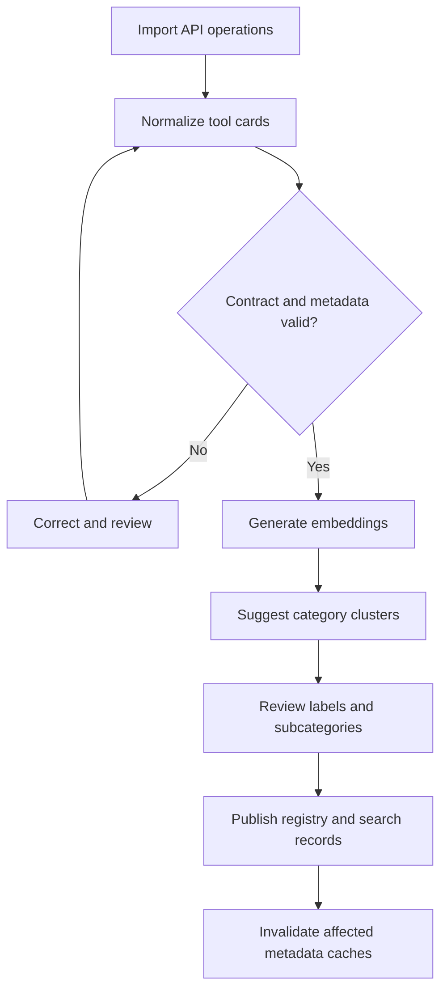
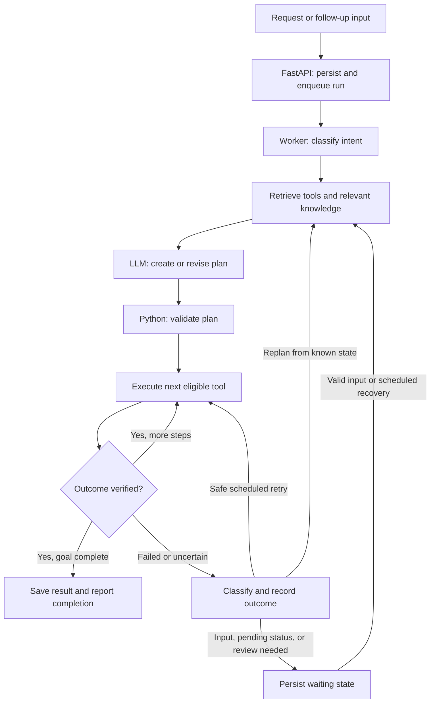

# Simplified Agentic System — High-Level Design

Version: 0.1 — initial implementation  
Date: 13 October 2026  
Scope: 50+ API operations for invoices, payments, refunds, disputes, and reporting, with a path to expand.

## 1. Objective and implementation scope

Build a chatbot that discovers relevant tools, shares a small context with the LLM, creates a validated plan, executes it, and resumes interrupted work from PostgreSQL.

Start with one Python codebase and two processes: a FastAPI application and one background worker. The worker executes a LangGraph workflow and also performs lightweight ingestion, retry scheduling, and recovery. Keep execution sequential initially.

| Layer | Selected component | Role |
|---|---|---|
| API | Python / FastAPI | Request submission, conversation interaction, progress, input/approval, cancellation |
| Orchestration | LangGraph with an LLM | Intent classification, planning, tool execution routing, and bounded recovery |
| State management | PostgreSQL-backed LangGraph checkpoints plus application records | Persist graph progress, schedule runs, and record external operations |
| Application data | PostgreSQL | Tools, runs, operation records, conversation references, knowledge metadata, trajectories |
| Retrieval | PostgreSQL full-text search plus pgvector | Lexical and semantic retrieval of tools, documents, and execution examples |
| Caching | Redis | Tool metadata, safe knowledge responses, session acceleration, status summaries |
| Documents / large payloads | Object storage with database references | Original documents and large tool inputs/outputs |
| LLM observability | Langfuse | Prompts, model responses, retrieval, tool calls, cost, latency, and outcome scores |
| Infrastructure telemetry | Correlated logs, metrics, and distributed traces | API/worker health, database failures, tool latency, and recovery monitoring |

This version uses application-managed recovery and scheduling without Temporal. Kafka, distributed compensation orchestration, and separate agents per category are outside the initial scope.

## 2. Tool onboarding → embeddings → clustering

### Onboarding flow



Import OpenAPI definitions, Postman exports, or manually defined API operations. Treat each callable operation as a tool with a stable ID. Normalize it into a tool card before creating embeddings.

Minimum tool-card fields:

- Tool ID, name, purpose, provider, adapter reference, and schema version.
- Input/output schemas, required identifiers, examples, and synonyms.
- Domain/category/subcategory tags and affected business entities.
- Read/write classification, required permissions, and tenant/resource restrictions.
- Preconditions, success criteria, timeout, expected errors, and retry behavior.
- Idempotency support, key requirements and retention, and status-lookup method.

Embed semantic descriptions and business capabilities. Clustering proposes categories and optional subcategories; a reviewer approves labels and security/execution metadata before publication.

Keep a shallow taxonomy. Add subcategories when tools represent distinct capabilities and the split improves retrieval. Category size alone does not justify a new level. A tool can carry multiple tags, so a payment-refund operation can relate to both payments and disputes.

Persist the approved tool cards and embeddings in PostgreSQL. API adapters remain ordinary Python modules behind an allowlisted gateway. Generated descriptions and cluster labels cannot grant permissions or define an executable endpoint.

## 3. Intent classification → tool selection → reduced context

The intent classifier receives the user request, necessary conversation facts, and a compact list of supported intent/category descriptions. It produces structured fields: goal, action, entities, constraints, relevant categories, and missing information.

For example, “Send an invoice to customer ABC for order O123” produces an invoice-send goal with customer and order references. If the customer is ambiguous, request clarification before a write. Compound requests become subgoals that may use different categories.

Tool selection then follows this sequence:

1. Apply mandatory user/tenant, environment, availability, and permission filters.
2. Use classified categories as relevance signals to prioritize the eligible tools.
3. Combine full-text matches with pgvector similarity over tool descriptions.
4. Retrieve approximately 3–5 candidates per subgoal as an initial tuning value.
5. Load the necessary schemas for those candidates and retrieve a few relevant policy passages.
6. Supply that compact context to the planner. Expand authorized retrieval if a required capability is absent.

Classification is a discovery signal. Risk, permissions, and executable business rules come from reviewed metadata and Python checks.

### What the planner receives

| Context item | Context-reduction rule |
|---|---|
| User request | Current goal and only relevant conversation facts |
| Tools | Selected candidate cards and required schemas; exclude the complete catalog |
| Policies / documentation | Relevant passages with source/version references |
| Current business data | Required fields from live tool reads; large responses stay outside the prompt |
| Historical executions | A small number of sanitized, applicable plan summaries |
| State and failures | Completed-step summaries, pending work, and actionable failure evidence |

Persisting information does not require sending it all to the LLM. Python graph nodes may inspect the full stored state and select only the fields needed for the next model call. Bound the context, plan length, retries, and number of replans through application configuration.

## 4. LangGraph runtime flow



The diagram is a logical flow. A resumed run loads its checkpoint and continues the appropriate pending node; it does not automatically restart classification. Any resumed write passes through the operation guard described below. An unresolved prior write must be reconciled before replanning an alternative write.

Suggested graph nodes are classify, retrieve, plan, validate, execute-next, verify, recover, and respond. A waiting node can pause for missing information or approval when business policy requires it.

The planner returns registered tool IDs, parameters or references to previous outputs, dependency order, and completion conditions. Python validates schemas, authorization, dependencies, and limits before execution. Start with sequential tool calls and simple linear plans; retain dependency fields for later expansion.

Use live APIs for current payment, invoice, refund, and dispute state. Use RAG for policies, API documentation, and process guidance. For reporting requests, resolve date boundaries, timezone, sales definition, and currency rules, and perform calculations in deterministic Python code.

## 5. State management in PostgreSQL

### Identities and state ownership

Create one application `run_id` and one LangGraph `thread_id` per workflow. Keep a separate `conversation_id` so a chat can contain several workflows. Reuse the thread identity to resume an existing workflow; create a new identity for a separate request.

| Record | Owner and purpose |
|---|---|
| Graph checkpoints | LangGraph checkpointer: graph state, completed node outputs, and pending execution information |
| `workflow_runs` | Application: scheduling, principal/tenant, lifecycle status, worker ownership, heartbeat, retry time, graph version |
| `tool_operations` | Application: external operation identity, parameters, attempts, provider references, observed outcome |
| Actual financial resource | External provider: authoritative business status |

Use the PostgreSQL checkpointer supplied for LangGraph rather than implementing a checkpoint format. Select synchronous checkpoint persistence for this initial design so progress is saved before continuing to the next graph step. Checkpoints support recovery, but the application worker still supplies scheduling and restart handling. See [LangGraph checkpointers](https://docs.langchain.com/oss/python/langgraph/checkpointers).

### Graph state

Keep serializable state containing the goal, entities, candidate IDs, versioned plan, completed-step summaries, small result fields or references, pending operation IDs, retry/replan counters, and waiting information.

```json
{
  "run_id": "run_123",
  "conversation_id": "chat_456",
  "goal": "Check eligibility and refund payment P123",
  "intent": "refund_payment",
  "entities": {"payment_id": "P123"},
  "candidate_tool_ids": ["get_payment", "refund_payment"],
  "plan_version": 1,
  "completed_steps": ["lookup_payment", "check_eligibility"],
  "pending_operation_id": "op_789",
  "result_refs": {"payment": "result_321"},
  "retry_count": 0,
  "replan_count": 0
}
```

### Run lifecycle and worker recovery

| Run status | Meaning and next action |
|---|---|
| `queued` | Persisted and ready for a worker |
| `running` | Owned by the worker; heartbeat updated while processing |
| `waiting_for_input` | Resume after valid clarification or required approval |
| `waiting_for_retry` | Resume when the persisted retry time is due |
| `waiting_for_reconciliation` | Resolve an uncertain or pending provider operation before proceeding |
| `completed` | All required business postconditions verified |
| `failed` | Known failure with no permitted automatic recovery |
| `needs_review` | Human review required because uncertainty or a recovery budget remains unresolved |
| `cancelled` | Remaining work stopped; any existing external effects remain recorded |

FastAPI commits acceptance before returning a run ID. The worker claims work through an atomic database transition, loads the checkpoint, and advances the graph. It periodically scans due retries and waits that are ready to resume. User-input waits resume only after new input is persisted and authorized.

Initially run one active worker. After a confirmed worker failure, recover its abandoned runs from PostgreSQL. A stale heartbeat flags a run for investigation; it is not proof that an external API call had no effect. Do not let a replacement worker overlap an active owner. Multiple-worker support later requires exclusive run claims and lease/ownership enforcement.

Graph checkpoints and application rows are separate persistence operations. Recovery handles discrepancies: for example, a tool result may be saved while the graph checkpoint still points to the execution node. The operation guard makes that node safe to revisit.

## 6. Tool execution guard and failure recovery

For every intended state-changing action, allocate a stable `operation_id` and retain it through retries and replanning. Do not deduplicate financial operations based on semantic similarity. An independently authorized new action has a new operation ID.

Before dispatch, persist the tool/schema version, canonical input hash, caller/tenant, provider idempotency key, and dispatch status. Enforce uniqueness and atomic status transitions in PostgreSQL. After the API returns, persist its result or error and then return that observation to the graph for checkpointing.

Every write node checks the existing operation before issuing a call:

| Existing operation evidence | Required behavior |
|---|---|
| Verified success | Return the saved result without repeating the write |
| Accepted but pending | Query status or wait; do not report completion |
| Dispatch started and outcome unknown | Reconcile with the provider before another write |
| Known failure | Apply the reviewed retry rule or bounded recovery |
| No operation exists | Validate, create the operation record, and dispatch |

Reuse the same provider idempotency key for the same action and unchanged payload, within the documented retention window. Reject reuse with changed parameters. Configure HTTP/SDK retries to follow the same rule. A local database record cannot eliminate the uncertainty between provider execution and recording its response.

Example: a refund succeeds at the provider, but the worker crashes before saving its response. On recovery, query the provider or use its supported idempotency mechanism; do not submit a new refund. If the response was saved but checkpointing failed, return that saved response when the node resumes.

| Failure type | Initial recovery policy |
|---|---|
| Missing or invalid parameters | Ask for information or repair before dispatch |
| Transient read failure | Bounded retry with backoff |
| Rate limit | Persist next retry time and respect provider guidance |
| Permission or business-rule rejection | Explain or stop; do not bypass with a different tool |
| Failed strategy with no unresolved write | Retrieve alternatives and replan from verified state |
| Ambiguous write | Reconcile; otherwise mark `needs_review` |

If a provider has no reliable idempotency or lookup support, do not automatically repeat an ambiguous write. Where webhooks are available, authenticate and deduplicate them before changing operation state. Scheduled status reads provide the simpler polling fallback. Cancellation stops future work and still preserves or reconciles already dispatched operations.

## 7. Minimal application data model

| Table / storage | Key contents |
|---|---|
| `tool_registry` | Tool card, adapter reference, tags, schema version, searchable text, embedding, enabled status |
| `workflow_runs` | Run/thread/conversation IDs, tenant/user, request reference, graph version, status, owner, heartbeat, retry time, result/error |
| `tool_operations` | Stable operation ID, run/step identity, tool version, input hash, provider key/ID, operation status, attempts, result/error references |
| LangGraph checkpoint tables | Managed through the PostgreSQL checkpointer |
| `conversation_messages` | Scoped conversation messages, clarification, and approval references |
| `knowledge_chunks` | Searchable passages, embeddings, source/object reference, version/effective date, access scope |
| `trajectory_summaries` | Normalized goal, plan summary, failures/recovery, verified outcome, versions, access scope |
| `payload_refs` | Object-storage keys, ownership/access scope, content type, checksum, and related run/operation |

Keep the original documents and large payloads in object storage. Use tool-operation records and graph checkpoints for recovery; Langfuse traces are diagnostic records, not the recovery database.

## 8. Knowledge, trajectories, caching, and observability

Start knowledge retrieval with API documentation and a small set of business policies. Return source/version references with relevant passages. Store only evaluated execution summaries as reusable trajectories. Filter historical examples by tenant/access scope and tool/policy compatibility; failed cases can inform recovery but never authorize new actions.

Redis caches tool metadata by registry version, safe knowledge responses by policy/access scope and expiry, and short-lived session or progress summaries. PostgreSQL remains authoritative if Redis loses data. Do not reuse a semantically similar financial result as evidence of a new completed operation.

Correlate FastAPI, LangGraph, adapters, logs, and Langfuse with run, operation, and trace IDs. Record selected candidates, plan versions, tool attempts, errors, recovery decisions, verification, latency, and cost. Redact credentials and sensitive data. Large payloads remain referenced instead of being copied into every checkpoint and trace.

Initial measures: tool-selection accuracy, verified goal completion, context tokens, tool-call count, latency, retry/replan count, interrupted-run recovery, unresolved-operation age, and duplicate or unauthorized writes. Compare the small-candidate retrieval strategy against an all-eligible-tools baseline before tuning thresholds.

## 9. API surface and delivery sequence

| Endpoint | Behavior |
|---|---|
| `POST /runs` | Validate identity, persist a new request, and return `run_id` with queued status; an explicit client submission key prevents duplicate resubmissions |
| `GET /runs/{run_id}` | Return authorized progress, waiting reason, result, or error |
| `POST /runs/{run_id}/input` | Persist clarification or policy-required approval and make the run resumable |
| `POST /runs/{run_id}/cancel` | Stop remaining work while preserving known and uncertain external effects |

Build in this order:

1. Tool cards, adapters, embeddings, reviewed categories, and read-only retrieval.
2. LangGraph intent/retrieval/planning/validation/execution flow with reduced context.
3. PostgreSQL checkpoints, run scheduling, worker recovery, and operation guards.
4. Selected writes with current-state checks, idempotency, reconciliation, and policy-required approval.
5. Object storage, safe Redis caches, trajectory reuse, and end-to-end telemetry.

Before enabling writes, check restart after provider success but before acknowledgment, a result saved before checkpointing, duplicate submission, pending provider results, Redis loss, permission changes, and cross-tenant access. Require safe recovery or an explicit review state in each case.

The remaining configuration decisions are the exact API inventory, allowed write operations, user/tenant model, approval rules, provider idempotency/lookup capabilities, retry budgets, reporting definitions, and retention settings. Initial candidate counts and timeout values are tuning choices; this HLD does not assume measured throughput or latency guarantees.

## 10. Reference documentation

- [LangGraph persistence](https://docs.langchain.com/oss/python/langgraph/persistence)
- [LangGraph checkpointers and durability modes](https://docs.langchain.com/oss/python/langgraph/checkpointers)
- [pgvector, including hybrid search](https://github.com/pgvector/pgvector)
- [Langfuse application tracing](https://langfuse.com/docs/observability/overview)
- [PayPal endpoint-specific idempotency](https://developer.paypal.com/api/rest/reference/idempotency/)
