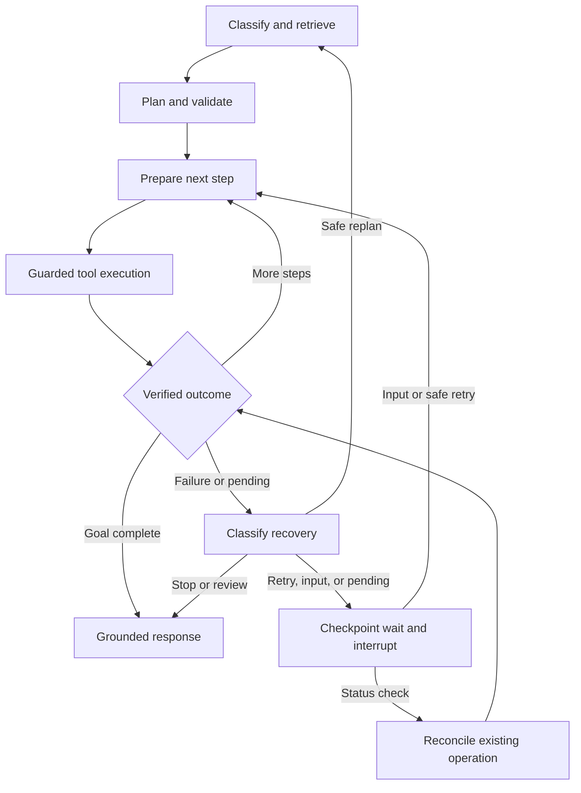

# Simplified Agentic System — Low-Level Design

Version: 0.1 — implementation blueprint  
Date: 13 October 2026  
Basis: Simplified_Agentic_System_HLD.md and the subsequent requirement for separate RAG Pipeline and System Search tools.

## 1. Implementation decisions

Use one Python repository with a FastAPI process and one active worker process. The worker drives a sequential LangGraph graph, polls PostgreSQL for runnable work, and resumes checkpoints. Administrative tool/document ingestion is exposed through a CLI initially.

Selected components: FastAPI, LangGraph, PostgreSQL, pgvector, Redis, object storage, Langfuse, and correlated infrastructure telemetry. Add SQLAlchemy/Alembic for application models/migrations, Psycopg for the LangGraph PostgreSQL checkpointer, HTTPX for external adapters, Pydantic for typed contracts, and JSON Schema validation for imported tool schemas. Lock compatible dependency versions after integration checks; this design does not assume a specific latest release.

Implementation boundaries:

- PostgreSQL records own application execution evidence; LangGraph checkpoints own graph progress.
- No Temporal or Kafka in v1. Redis is a cache, not the execution queue.
- One active worker and one graph invocation at a time. Multiple requests can be queued.
- One external business operation per execution-node invocation; no parallel financial writes.
- Models propose intent and plans. Python resolves bindings, enforces authorization, dispatches tools, and verifies outcomes.

### Graph v2 execution policy

New runs use graph v2. Intent includes `execution_mode` (`plan_only` or `execute`) and ordered subgoals. Retrieval builds a separate eligible shortlist per subgoal. `plan_only` returns those steps and suggestions without dispatch. For `execute`, the model receives only the current subgoal's shortlist as function declarations and may propose one function call. Python resolves the name only within that shortlist and validates the published input schema and refreshed authorization. Reads dispatch through the existing execution service. Each write pauses with an operation-bound approval request; the owner can type `approve` or `reject` in chat, and the server validates the pending operation before resuming dispatch. Scopes, preconditions, immutable operation tracking, idempotency and output verification remain mandatory. Uncertain write outcomes stop for review and cannot be approved into a retry.

The provider-neutral gateway returns typed function calls and opaque continuation state. Gemini uses Interactions stateless mode (`store=false`), checkpointing the full provider history needed to continue a function call, including thought signatures. It sends a function result only after the application validates and executes the call. Continuation data is never returned by APIs or the UI. Graph v1 remains installed to resume older in-progress or paused runs. Tool declarations come only from per-subgoal retrieval.

V2 test runs append redacted request/response, declaration, selected-function and tool-result records to `runtime/llm-traces/<run-id>.jsonl`. The trace omits provider signatures and is separate from public LLM activity.
This document specifies contracts and algorithms. Code fragments are reference skeletons, not a completed application or tested deployment.

## 2. Repository modules and service interfaces

| Module / file | Responsibility |
|---|---|
| `app/main.py`, `app/api/routes_runs.py` | FastAPI application, request validation, run submission, status, input, cancellation |
| `app/api/dependencies.py` | Trusted identity, tenant binding, ownership checks, request correlation |
| `app/core/settings.py`, `app/core/lifecycle.py` | Configuration, connection pools, HTTP clients, telemetry startup/shutdown |
| `app/models/`, `app/repositories/`, `migrations/` | Application database models, scoped queries, atomic transitions, migrations |
| `app/registry/cards.py`, `app/registry/service.py` | Tool contracts, adapter mapping, version publication and revocation |
| `app/ingestion/tools.py`, `app/ingestion/documents.py` | Import, normalize, extract, chunk, embed, publish |
| `app/retrieval/hybrid.py`, `app/retrieval/context.py` | Authorized lexical/vector retrieval, fusion, token-budgeted context |
| `app/taxonomy/clustering.py` | Offline clustering proposals and reviewed label mappings |
| `app/graph/state.py`, `app/graph/builder.py`, `app/graph/nodes.py` | State contract, graph transitions, classify/plan/execute/verify/wait nodes |
| `app/planning/contracts.py`, `app/planning/validator.py` | Structured plan schema, output bindings, deterministic plan checks |
| `app/tools/base.py`, `app/tools/gateway.py`, `app/tools/adapters/` | Adapter interface, operation guard, external calls, error normalization |
| `app/tools/rag_pipeline.py`, `app/tools/system_search.py` | Two registered internal read-only tools |
| `app/worker/main.py`, `app/worker/scheduler.py`, `app/worker/recovery.py` | Claim work, invoke/resume graph, due waits, startup repair |
| `app/storage/payloads.py`, `app/cache/service.py` | Object references, authorized retrieval, cache policy and invalidation |
| `app/observability/`, `app/cli.py`, `tests/` | Langfuse/telemetry, administrative commands, acceptance and failure scenarios |

Construct these services once per process. FastAPI lifecycle initializes and closes resources; it does not launch an independent durable job for each request. The worker is a separate supervised process.

Core service signatures:

```python
class RunService:
    async def submit(self, request, principal, submission_key): ...
    async def get_status(self, run_id, principal): ...
    async def accept_input(self, run_id, response, principal): ...
    async def request_cancel(self, run_id, principal): ...

class RetrievalService:
    async def tools(self, query, category_ids, principal, limit): ...
    async def knowledge(self, query, corpus_ids, principal, limit): ...
    async def trajectories(self, goal, versions, principal, limit): ...

class ExecutionService:
    async def execute_step(self, step, state, principal): ...
    async def reconcile(self, operation_id, principal): ...
```

Pass trusted context separately from model-supplied arguments. Never accept a model-selected tenant, owner, credential, arbitrary SQL query, or endpoint URL as authority.

## 3. Tool registry and onboarding implementation

### Tool card contract

| Field | Type / rule |
|---|---|
| `tool_id`, `schema_version` | Stable string ID and immutable published version |
| `adapter_key` | Key into a Python-maintained adapter allowlist |
| `name`, `description`, `examples`, `synonyms` | Search and prompt material; strip secrets and sensitive sample values |
| `category_ids`, `entities`, `action` | Reviewed multi-label discovery metadata |
| `input_schema`, `output_schema` | JSON Schema; imported references resolved during onboarding |
| `operation_type` | `read` or `write`, assigned by reviewed metadata |
| `required_scopes` | Trusted scope names, never inferred as authorization by the LLM |
| `precondition_key`, `verification_key` | Approved Python validators/status evaluators |
| `timeout_seconds`, `retry_policy` | Adapter-specific limits and safe retry classification |
| `idempotency` | Supported flag, header/field, retention, request consistency rules |
| `reconciliation_key` | Allowlisted status lookup function, or null |
| `provider`, `provider_account_key` | Provider routing metadata; credentials resolved separately |
| `status` | `draft`, `published`, `revoked`; current-version marker separate |
| `embedding_model`, `embedding_version` | Search-space compatibility metadata |

CLI flow: parse import → normalize card → validate schemas and adapter mapping → create embedding → propose categories → review descriptive metadata → deterministically validate execution metadata → publish immutable versions. Collection onboarding evaluates the configured clustering distance against representative retrieval queries. Gemini may label categories and approve descriptive metadata, but cannot alter or approve schemas, endpoints, adapters, scopes, operation types or write policies. Taxonomy updates and all tool publications from one reviewed batch commit atomically. Old versions remain readable for pinned plans unless explicitly revoked.

The collection CLI also supports `--reviewer manual` for local operation without
Gemini calls. That mode uses the configured distance threshold, route-family
labels and deterministic descriptive checks; it leaves ambiguous identity-token
actions in draft. The Gemini reviewer remains the default.

The registry includes `rag_pipeline` and `system_search` as ordinary read-only tools. Their adapters are Python implementations rather than third-party endpoints. Contract checks cover both internal and external tools.

### Clustering algorithm

For the small initial catalog, normalize description embeddings and use average-linkage clustering over cosine distance. Start with each tool as a cluster; merge the closest clusters while their average distance is below a configured threshold. Evaluate nearby threshold values against representative retrieval queries. Produce representative tools and suggested labels for Gemini review. Gemini reviews descriptive metadata and assignments; deterministic checks gate publication.

Use this to propose broad categories. Propose a second level only where the tools form distinct capability groups; do not split automatically at a fixed tool count. Reviewers may add secondary tags for cross-domain tools. Keep category IDs stable by reusing IDs with the strongest membership overlap; a re-cluster remains a proposal until auto-review and deterministic gates pass. Choose the distance threshold using representative retrieval queries, not a claimed universal value.

Document ingestion uses a separate CLI: upload original → extract text/headings → bounded chunks with overlap → embed → write unpublished document/chunks → atomically activate the version and update the knowledge revision. Failed ingestion leaves the previous version active. Retain document ACL, effective dates, source identity, and checksum with every chunk.

## 4. Intent, retrieval, and context contracts

### Classification output

```json
{
  "goal": "Send an invoice for order O123",
  "subgoals": [{"id": "g1", "action": "send", "entity": "invoice"}],
  "category_ids": ["invoicing"],
  "entities": {"order_id": "O123"},
  "constraints": {},
  "missing_fields": ["customer_reference"],
  "confidence": 0.8
}
```

Validate model output with strict Pydantic models (`extra='forbid'`). Confidence is advisory and calibrated through evaluation, not a permission signal. Unknown category IDs are rejected or ignored in favor of eligible global retrieval. Ambiguous resource identity, amount, or currency becomes a clarification wait before dispatch.

### Hybrid retrieval algorithm

1. Build the eligible tool set using tenant, principal scopes, enabled state, and environment. Category relevance is soft, while access restrictions are hard.
2. Run lexical and vector searches within that set. Retrieve up to 20 from each as configurable starting values.
3. Combine ranks with reciprocal-rank fusion: `score(t) = w_text/(60 + rank_text) + w_vector/(60 + rank_vector)`. A missing rank contributes zero. Apply a small optional category preference; do not exclude necessary cross-domain capabilities.
4. Deduplicate by current tool ID/version and return 3–5 candidates per subgoal.
5. If coverage is inadequate, widen discovery within the same authorized set. Do not send every tool schema just because classification is uncertain.

Use exact pgvector search initially for the approximately 50-tool catalog. Knowledge and trajectory collections can be larger and evaluated separately for approximate indexes. Embedding dimensions and versions must match query vectors.

Implementation SQL shapes, using bound parameters:

```sql
-- eligible_tools is a scoped CTE/view assembled by the repository.
SELECT tool_id, schema_version,
       ts_rank_cd(search_vector, websearch_to_tsquery('simple', :query)) AS score
FROM eligible_tools
WHERE search_vector @@ websearch_to_tsquery('simple', :query)
ORDER BY score DESC, tool_id
LIMIT :candidate_limit;

SELECT tool_id, schema_version
FROM eligible_tools
ORDER BY embedding <=> CAST(:query_vector AS vector), tool_id
LIMIT :candidate_limit;
```

### Context builder

The classifier receives the current question, scoped conversation summary, and compact category/intent descriptions. The planner receives selected cards and schemas, relevant document passages, up to two compatible trajectory summaries, required current-state fields, and concise failure evidence.

Configure a total input token budget and output reserve; suggested initial limits are 8,000 input tokens, 2,000 output tokens, 5 candidate tools per subgoal, 4 knowledge passages, and 2 trajectories. Verify these against the selected model. Count the system prompt and schemas in the budget. Drop low-ranked optional context first; never truncate a selected tool's schema into an invalid contract. If required contracts do not fit, plan a smaller subgoal.

Treat retrieved content as data. Include source IDs and freshness, exclude credentials and raw large payloads, and return typed observations from tools. Search indexes, graph state, and LLM context are separate representations.

## 5. Plan and graph-state contracts

### Plan representation

```json
{
  "plan_version": 1,
  "steps": [
    {
      "step_id": "s1",
      "tool_id": "get_payment",
      "schema_version": "1",
      "depends_on": [],
      "arguments": {"payment_id": {"literal": "P123"}}
    },
    {
      "step_id": "s2",
      "tool_id": "refund_payment",
      "schema_version": "1",
      "action_ref": "refund_primary",
      "depends_on": ["s1"],
      "arguments": {
        "payment_id": {"from_step": "s1", "path": "/payment_id"},
        "amount": {"literal": "2000.00"},
        "currency": {"literal": "INR"}
      }
    }
  ]
}
```

Use a discriminated binding: literal value OR a previous step ID plus JSON Pointer. Resolve it in Python against schema-validated output; no `eval`, templating expressions, or model-generated code. Store money as decimal strings and validate currency/precision in adapters. The example omits eligibility lookup/verification steps for brevity; the validator must enforce the selected business template's prerequisites.

Plan validation rejects unknown/revoked versions, unauthorized tools, duplicate step IDs, cycles, future/missing output references, input-schema mismatches, excessive steps, and missing write preconditions. In v1, dependencies must refer to earlier steps and execution stays sequential.

Assign business `action_ref` slots in Python and persist them before dispatch. Each intended write gets one stable operation identity, independent of plan/step numbers. A replan must preserve existing action slots and completed effects. Do not let the LLM create a new financial action merely to bypass a failed or unresolved operation. v1 permits automatic alternate read tools; switching a dispatched write to another adapter requires a known no-effect outcome and explicit validated authorization, otherwise review.

### Graph state

```python
from typing import Any, TypedDict

class AgentState(TypedDict, total=False):
    run_id: str
    thread_id: str
    conversation_id: str
    request_text: str
    intent: dict[str, Any]
    candidate_tools: list[dict[str, Any]]
    knowledge_refs: list[str]
    plan: dict[str, Any]
    step_index: int
    results: dict[str, dict[str, Any]]
    action_map: dict[str, str]
    observation: dict[str, Any]
    wait_request: dict[str, Any]
    last_input_id: str
    retry_counts: dict[str, int]
    replan_count: int
    routing_decision: str
    final_result: dict[str, Any]
```

Identity and authorization are loaded from the run record by the worker, not trusted from editable graph arguments. `results` holds small typed output and payload references. Nodes return partial state updates; use replacement semantics for these fields in the sequential graph. Pin graph, prompt, tool, policy, and embedding versions. Retain completed action outcomes when a plan is revised.

## 6. Graph nodes and transition rules

| Node | Input / behavior | Routing |
|---|---|---|
| `classify` | Structured intent and missing fields | Missing → prepare wait; otherwise retrieve |
| `retrieve` | Authorized tools plus compact optional knowledge/trajectory context | Plan |
| `plan` | Structured LLM plan; record version | Validate |
| `validate` | Deterministic plan checks and action-slot mapping | Valid → prepare step; fixable → recover; input needed → prepare wait |
| `prepare_step` | Cancellation, fresh authorization, resolve bindings, preconditions, required approval | Execute or prepare wait |
| `execute` | Exactly one guarded adapter call or saved operation result | Verify |
| `verify` | Evaluate provider/internal-tool postcondition | Next step → prepare step; pending/failure → recover; goal complete → respond |
| `recover` | Classify failure and increment bounded counters | Retry wait, reconcile wait, re-retrieve, respond, or review |
| `prepare_wait` | Create and checkpoint a stable wait token, reason, due time, expected input contract | Wait |
| `wait` | Interrupt, then validate resume envelope | Clarification → classify; approval/retry → prepare step; reconcile → reconcile |
| `reconcile` | Status lookup for existing operation; never a fresh business write | Verify or another wait/review |
| `respond` | Generate a grounded result/status; deterministic monetary totals | END |

Every conditional edge maps an allowlisted routing string to a node. Invalid routing is an application error, not an arbitrary model-selected jump. Business completion requires verified postconditions; finishing a graph with a pending/review outcome does not mean a payment completed.



Use `AsyncPostgresSaver` with an async LangGraph invocation and synchronous durability. Initialize checkpointer tables through the supported setup/migration path before accepting jobs. The conceptual wiring is:

```python
graph = builder.compile(checkpointer=postgres_checkpointer)
config = {"configurable": {"thread_id": run.thread_id}}

# First invocation only:
result = await graph.ainvoke(initial_state, config, durability="sync")

# Recover an interrupted execution with no user interrupt pending:
result = await graph.ainvoke(None, config, durability="sync")

# Resume a persisted wait with an authorized input envelope:
from langgraph.types import Command
result = await graph.ainvoke(Command(resume=resume_envelope), config,
                             durability="sync")
```

The worker chooses one of these inputs after inspecting the saved snapshot. A running workflow is not restarted with its original request. A graph with a recorded interrupt requires its matching resume input. A completed snapshot is used to repair final run status without re-execution. LangGraph-managed checkpoint schemas remain separate from application migrations. Set an explicit graph recursion limit, initially 200 node transitions per invocation, in addition to the persisted business retry/replan budgets; reaching either limit yields an explained failure or review state.

## 7. PostgreSQL application schema

Use UUIDs generated in the application, `timestamptz` timestamps in UTC, JSONB for validated small contracts, and explicit enums/CHECK constraints for lifecycle states. Every application record is tenant-scoped; all repositories require a trusted tenant. Add composite tenant foreign keys where records relate across tables.

### Core execution DDL

The following is the core migration shape. It is executable SQL for these three tables; related registry, conversation, and payload relationships are added in the migrations described below.

```sql
CREATE TABLE workflow_runs (
    run_id uuid PRIMARY KEY,
    tenant_id uuid NOT NULL,
    user_id text NOT NULL,
    conversation_id uuid NOT NULL,
    thread_id text NOT NULL UNIQUE,
    submission_key text NOT NULL,
    request_hash text NOT NULL,
    request_payload jsonb NOT NULL,
    graph_version text NOT NULL,
    prompt_version text NOT NULL,
    status text NOT NULL CHECK (status IN (
        'queued','running','waiting_for_input','waiting_for_retry',
        'waiting_for_reconciliation','completed','failed',
        'needs_review','cancelled')),
    wait_token uuid,
    wait_kind text,
    due_at timestamptz,
    cancel_requested boolean NOT NULL DEFAULT false,
    worker_id text,
    heartbeat_at timestamptz,
    result_payload jsonb,
    error_payload jsonb,
    trace_context jsonb,
    row_version bigint NOT NULL DEFAULT 0,
    created_at timestamptz NOT NULL DEFAULT now(),
    updated_at timestamptz NOT NULL DEFAULT now(),
    UNIQUE (tenant_id, run_id),
    UNIQUE (tenant_id, user_id, submission_key)
);

CREATE INDEX workflow_runnable_idx ON workflow_runs (status, due_at, created_at);
CREATE INDEX workflow_user_history_idx
    ON workflow_runs (tenant_id, user_id, created_at DESC, run_id DESC);

CREATE TABLE tool_operations (
    operation_id uuid PRIMARY KEY,
    tenant_id uuid NOT NULL,
    run_id uuid NOT NULL,
    action_ref text NOT NULL,
    tool_id text NOT NULL,
    schema_version text NOT NULL,
    operation_type text NOT NULL CHECK (operation_type IN ('read','write')),
    provider text NOT NULL,
    provider_account_key text NOT NULL,
    input_hash text NOT NULL,
    input_payload jsonb NOT NULL,
    idempotency_key text,
    idempotency_expires_at timestamptz,
    provider_operation_id text,
    status text NOT NULL CHECK (status IN (
        'prepared','dispatching','pending','succeeded','failed','unknown')),
    attempt_count integer NOT NULL DEFAULT 0 CHECK (attempt_count >= 0),
    result_payload jsonb,
    payload_ref uuid,
    error_payload jsonb,
    verified_at timestamptz,
    next_check_at timestamptz,
    row_version bigint NOT NULL DEFAULT 0,
    created_at timestamptz NOT NULL DEFAULT now(),
    updated_at timestamptz NOT NULL DEFAULT now(),
    FOREIGN KEY (tenant_id, run_id) REFERENCES workflow_runs (tenant_id, run_id),
    UNIQUE (tenant_id, run_id, action_ref),
    UNIQUE (tenant_id, provider, provider_account_key, tool_id, idempotency_key)
);

CREATE INDEX operation_pending_idx
    ON tool_operations (status, next_check_at);

CREATE TABLE workflow_inputs (
    input_id uuid PRIMARY KEY,
    tenant_id uuid NOT NULL,
    run_id uuid NOT NULL,
    wait_token uuid NOT NULL,
    actor_id text NOT NULL,
    kind text NOT NULL CHECK (kind IN ('clarification','approval','timer')),
    payload jsonb NOT NULL,
    payload_hash text NOT NULL,
    status text NOT NULL CHECK (status IN ('pending','applied','rejected')),
    created_at timestamptz NOT NULL DEFAULT now(),
    applied_at timestamptz,
    FOREIGN KEY (tenant_id, run_id) REFERENCES workflow_runs (tenant_id, run_id),
    UNIQUE (tenant_id, run_id, wait_token)
);
```

Writes reuse a business action reference. Read actions can have execution-generation references such as `read:s1:plan1`; fresh verification reads receive new references while crash replay of the same read can reuse its saved observation. Preserve the exact normalized approved request for hashing and safe retries, either in restricted input JSONB or an authorized object reference; redact exports rather than destructively redacting the recovery record. Minimize unrelated input/result fields.

### Remaining tables and constraints

| Table | Fields / keys / indexes |
|---|---|
| `conversations` | `(tenant_id, conversation_id)` unique, owner `user_id`, title, created/updated timestamps; used for composite run ownership FK |
| `conversation_messages` | UUID, tenant/conversation, optional run/input IDs, role, text or payload reference, timestamp; index scoped conversation/time |
| `tool_registry` | PK `(tenant_id, tool_id, schema_version)`; card JSONB, searchable text/tsvector, embedding, embedding version, current marker, status; one published current version per tenant/tool; GIN text index |
| `taxonomy_categories` | PK `(tenant_id, category_id)`; parent ID, label, description, revision; maximum depth two; reviewed assignments carried by cards |
| `knowledge_documents` | UUID, tenant, corpus ID, source key, version, object reference, title, required scopes, effective dates, active status, checksum; scoped unique source/version |
| `knowledge_chunks` | UUID, tenant/document FK, chunk index, text, search vector, embedding/version, source locator; unique document/chunk index; GIN text index |
| `trajectory_summaries` | UUID, tenant/user access scope, source run FK, goal/plan summary, outcome, tool/policy/graph versions, search vector/embedding, review status; searchable only when approved |
| `payload_refs` | UUID, tenant, owning user/run, object key, content type, size, checksum, creation time; unique tenant/object key |
| `workflow_events` | UUID event key, tenant/run/optional operation IDs, event type, sanitized JSONB evidence, timestamp; index scoped run/time; append-only for application role |
| `system_versions` | Tenant PK, registry/taxonomy/knowledge/ACL revisions and update time; transactional publication and cache invalidation |

Create the pgvector extension during deployment. Select the embedding model and fixed dimension `D` before migrations, and use `vector(D)` consistently. Keep mismatched embedding versions out of retrieval; changing dimensions needs a new column/index or migration/re-embedding phase. Scope GIN/B-tree indexes to expected queries and benchmark vector indexes separately.

Do not allow cascading deletion of financial operation evidence while a run is pending. Add composite foreign keys for tool-version pinning and tenant payload/document relations. Preserve run/checkpoint associations until retention permits coordinated cleanup.

## 8. FastAPI contracts and transaction boundaries

| Endpoint | Contract / outcome |
|---|---|
| `POST /runs` | Required `Idempotency-Key`; body `conversation_id` optional and `message`; return 202 with run/status links after database commit |
| `GET /runs/{run_id}` | Authorized owner/scope check; return status, waiting reason, small progress/result, as-of timestamp |
| `POST /runs/{run_id}/input` | Body `wait_token`, `kind`, `payload`; validate expected wait and caller; persist input and queue resume; return 202 |
| `POST /runs/{run_id}/cancel` | Idempotently set cancellation flag; queued/input-wait work can stop immediately; dispatched writes remain reconciled |
| `GET /health/live` | Process liveness without provider calls |
| `GET /health/ready` | Required database/resources available; optional telemetry/cache degradation reported separately |

Example submission and accepted response:

```json
{"conversation_id": "d1399bcc-281d-4a99-b066-453fb322cbba", "message": "What tools manage invoices?"}
```

```json
{
  "run_id": "f7a1fbd1-9851-4e95-a4d8-fc8b66e6d87",
  "status": "queued",
  "status_url": "/runs/f7a1fbd1-9851-4e95-a4d8-fc8b66e6d87"
}
```

Submission transaction: resolve/create authorized conversation → compute canonical request hash → insert run with explicit submission key → append message/event → commit. On a unique-key conflict, roll back the attempted transaction before reading the existing scoped run, so no extra conversation/message remains. Return the existing run if the hash matches; return 409 for different content. A fresh intentional request needs a fresh key.

Input transaction locks the run, verifies wait token/kind and approval-bound payload, inserts one input for that token, and changes status to queued. A repeated identical response returns the existing acceptance; a conflicting response returns 409. Public clients cannot create internal timer inputs or submit provider reconciliation facts as truth.

Cancellation is cooperative: check before every dispatch and at resume. A network timeout or an in-flight write cannot be erased by cancellation; reconcile its final status and report recorded effects. Return `cancel_requested` while that work remains unresolved rather than promising immediate cancellation.

Standard errors use `code`, `message`, `request_id`, and safe `details`. Use 401 for no identity, 403 for prohibited actions, 404 for inaccessible/unknown resource IDs to limit enumeration, 409 for conflicting state/key reuse, and 422 for invalid request contracts. Authorization must also be checked in the worker after long waits.

## 9. Worker, scheduler, and checkpoint recovery

### Process ownership and claim

Deploy one worker replica and have its supervisor stop the old process before starting a replacement. A worker-instance UUID identifies ownership. Optionally hold a database advisory singleton lock on a dedicated connection as an additional deployment guard; losing that connection stops further dispatch. A lock or stale heartbeat alone does not prove that a remote API call stopped.

At startup, repair runs belonging to a confirmed terminated worker. Inspect checkpoints and operation records before making them runnable. If old-owner termination is uncertain, pause takeover and flag review. The initial design does not implement automatic multi-worker lease failover.

Claim a queued run in a short transaction:

```sql
WITH candidate AS (
    SELECT run_id
    FROM workflow_runs
    WHERE status = 'queued' AND cancel_requested = false
    ORDER BY created_at, run_id
    FOR UPDATE SKIP LOCKED
    LIMIT 1
)
UPDATE workflow_runs AS r
SET status = 'running', worker_id = :worker_id,
    heartbeat_at = now(), updated_at = now(), row_version = row_version + 1
FROM candidate AS c
WHERE r.run_id = c.run_id
RETURNING r.*;
```

Commit the claim before invoking the graph. Do not keep a database transaction open while waiting for the LLM, external API, or user. A separate heartbeat task updates only rows still owned by that worker. PostgreSQL row locks are used for queue claims, not held as financial locks across network calls.

### Invocation selection and status projection

| Saved condition | Worker action |
|---|---|
| No checkpoint | Invoke initial state using the pinned graph version |
| Checkpoint has pending work, no interrupt | Invoke with `None` to continue |
| Checkpoint has a matching interrupt and input | Invoke `Command(resume=envelope)` |
| Checkpoint has interrupt but no input | Repair waiting status and release ownership |
| Checkpoint is complete | Repair final result/status without rerunning |
| Operation is dispatching/unknown | Its execution guard must reconcile rather than dispatch a new write |

After graph invocation returns, write the appropriate waiting or final status and result in a transaction. The graph stores explicit `final_result.business_status` so `completed`, `failed`, and `needs_review` are distinguishable even when no graph node remains pending. Recover status from a checkpoint if this projection write failed.

### Persistent waits and input acknowledgment

`prepare_wait` generates a `wait_token`, reason, resume route, expected payload schema, and optional due time, then returns them for checkpointing. `wait` calls `interrupt()` with that existing state; it must not generate a new token or perform a financial action before the interrupt. Upon resume, the node validates token/kind, returns state updates, records `last_input_id`, and clears the consumed wait request.

LangGraph restarts the interrupted node when resuming, so pre-interrupt work must be repeatable. The persistent wait is published to `workflow_runs` after the checkpoint is saved. The worker inspects the actual checkpoint before applying any queued input, protecting against projection mismatches.

The scheduler scans due retry/reconciliation waits and atomically inserts one internal `timer` input per wait token, then queues the run. It does not use a long in-process sleep as the source of scheduling truth. Input IDs are included in resume envelopes. If the graph consumed an input but the worker crashed before marking it applied, the recovered `last_input_id` lets the worker acknowledge it without applying it again.

Use one outstanding interrupt at a time in v1. Scope queued-input acceptance to the expected wait token; ordinary users cannot provide timer or reconciliation evidence. Scheduled reconciliation waits may continue after cancellation to establish the outcome of a submitted write, while future business steps are skipped.

## 10. Adapter protocol and operation guard

### Adapter contract

```python
from dataclasses import dataclass
from typing import Any, Literal, Protocol

@dataclass(frozen=True)
class ToolContext:
    tenant_id: str
    user_id: str
    run_id: str
    operation_id: str
    idempotency_key: str | None

@dataclass
class ToolOutcome:
    state: Literal["succeeded", "pending", "failed", "unknown"]
    data: dict[str, Any]
    provider_operation_id: str | None = None
    error_code: str | None = None
    retryable: bool = False
    effect_known_absent: bool = False

class ToolAdapter(Protocol):
    async def invoke(self, arguments: dict[str, Any], context: ToolContext) -> ToolOutcome: ...
    async def reconcile(self, operation: dict[str, Any], context: ToolContext) -> ToolOutcome: ...
```

Adapters without reconciliation implement an explicit unsupported outcome. Credentials are loaded at the gateway from trusted tenant/provider configuration. The model sees neither tokens nor arbitrary account-routing keys.

### Guard algorithm

1. Resolve the pinned card and arguments; refresh principal authorization and resource ownership. Check cancellation, current business preconditions, approval evidence, input schema, and tool revocation.
2. Resolve the persisted action slot. Compute a canonical payload hash after argument resolution and business normalization. Reuse its stable operation ID; reject changed parameters or adapter identity for an already prepared action. Approval, when required, binds to this operation/hash, target, amount/currency, and principal.
3. In one short transaction, insert `prepared` or read the existing operation. Append a sanitized event. Unique action constraints protect against concurrent or replayed insertion.
4. Existing verified success returns the saved observation. `pending`, `unknown`, or stale `dispatching` routes to reconciliation. Known failure retries only when contract policy proves it safe. A prepared operation may dispatch.
5. Atomically change the eligible operation to `dispatching`, increment attempt count, and commit. Use compare-and-set status/row version; a failed transition means no call is issued.
6. Call exactly one adapter outside the transaction. Reuse the recorded idempotency key and unchanged payload. Make write transport retries opt-in and explicit.
7. Persist normalized observation, provider ID, result reference, and new operation state; append the event in the same transaction. A result is `succeeded` only when the contract's postcondition evaluator verifies it.
8. Return a small observation to LangGraph. If checkpointing subsequently fails, the repeated node reads the operation and does not repeat an already verified write.

Generate provider keys from the operation UUID where supported and store endpoint-specific retention/format requirements. Provider support determines whether a retry after ambiguous dispatch is safe. Automatic transport retries are disabled for writes unless explicitly covered by that guarantee.

| External observation | Normalized behavior |
|---|---|
| Valid verified completion | `succeeded`, with verified time |
| Accepted/queued response | `pending`, with provider reference and next status-check time |
| Timeout, connection lost after possible dispatch, or unparseable write response | `unknown`; reconcile |
| Clear input/permission/business-rule rejection | `failed`; reason mapped by adapter |
| Read-only transient failure | `failed` with safe retry flag |
| Write 5xx | Potentially `unknown`; never infer no effect just from HTTP status |

A provider “not found” response proves no effect only if its documented consistency/lookup semantics allow that conclusion. Wait and retry the lookup where status may lag. If idempotency has expired or reconciliation cannot establish the outcome, stop automatic write retry and use `needs_review`.

Local transactions atomically update operation evidence plus its event, not the external provider or LangGraph checkpoint. There is no universal exactly-once guarantee. Separate intended writes can also conflict; re-read current resource limits and rely on provider-enforced limits for changes outside this single worker.

## 11. RAG Pipeline Tool

Register `tool_id='rag_pipeline'`, `operation_type='read'`, category `knowledge`, and an adapter using the shared knowledge retrieval service.

### Public tool arguments

```json
{
  "query": "What are the refund eligibility rules?",
  "mode": "context",
  "corpus_ids": ["payment_guides"],
  "top_k": 4
}
```

Schema: query length 1–2,000 characters; mode `context` or `answer`; optional corpus IDs checked against access rights; `top_k` bounded 1–6. Identity and ACL scope are injected, never accepted as arguments.

Algorithm: authorize corpora → filter active/effective document versions → embed/search/fuse → choose bounded passages → attach source/document/chunk IDs and locators. `context` returns passages for the planner or final response. Optional `answer` runs one bounded answer-generation call using those passages and returns the supporting evidence; the outer response should not unnecessarily regenerate it.

Output contract:

```json
{
  "query": "What are the refund eligibility rules?",
  "sufficient_evidence": true,
  "answer": null,
  "passages": [{
    "chunk_id": "chunk-17",
    "document_id": "doc-4",
    "document_version": "3",
    "title": "Refund guide",
    "locator": "section 2",
    "text": "Relevant source passage",
    "score": 0.03
  }],
  "knowledge_revision": 12
}
```

If evidence is inadequate, return `sufficient_evidence=false`; do not fabricate a policy. Scores are ranking signals, not probabilities. An optional generated answer's source IDs must resolve to returned passages. Critical financial eligibility decisions remain enforced by approved policy code/current provider data, even when RAG supplies explanatory context.

Bootstrap planning knowledge can use this same retrieval service directly from `retrieve`; a user-requested knowledge task invokes `rag_pipeline` as a registered tool. The tool does not call the orchestrator recursively or run another tool-selection graph.

## 12. System Search Tool

Register `tool_id='system_search'`, `operation_type='read'`, category `system`, with three typed modes.

| Mode | Arguments | Data source / output |
|---|---|---|
| `capabilities` | `query`, optional category, bounded limit | Authorized published registry; tool IDs, names, descriptions, operation types, categories |
| `request_status` | Optional `run_id`, otherwise selector `last` | Scoped `workflow_runs` plus unresolved operation summaries; status, wait reason, result/error summary, as-of time |
| `execution_history` | Optional `run_id` or selector `last`, bounded limit/cursor | Sanitized `workflow_events` and operation evidence; ordered steps, attempts, failure/recovery summaries |

Use a discriminated Pydantic union so inappropriate fields are rejected per mode. The model supplies structured filters, not SQL, table names, log paths, principal IDs, or arbitrary predicates.

“My last request” resolves within the authenticated user's tenant and selected conversation by default, excluding the current system-search run. Order by `created_at DESC, run_id DESC`. Return the selected run ID and timestamp so the interpretation is explicit. If no conversation is provided, use the owner's tenant-scoped history. Other users' runs require a separately configured management permission; tenant identity alone is insufficient.

Capability discovery reuses the authorized tool-retrieval service and omits credentials, sensitive adapter configuration, and tools the user cannot access. Execution history uses database audit summaries, not unrestricted infrastructure logs or raw Langfuse traces. Current request status reads PostgreSQL directly and is not served from a stale semantic cache.

Example arguments and response shape:

```json
{"mode": "request_status", "selector": "last"}
```

```json
{
  "run_id": "prior-run-id",
  "status": "waiting_for_reconciliation",
  "summary": "The refund was submitted; its final outcome is being checked.",
  "operations": [{"operation_id": "op-id", "state": "unknown"}],
  "as_of": "2026-10-12T20:00:00Z"
}
```

The orchestrator has an internal bootstrap retrieval function to discover tools. It can always consider these two built-ins when the classified goal is relevant and permissions allow it; it does not need to call System Search to discover System Search. Direct `GET /runs/{id}` and this tool reuse the same status repository and ownership checks.

## 13. Trajectories, object storage, and Redis

After a completed/failed run, generate a sanitized trajectory summary keyed by source run and graph version. Include normalized goal, versioned tool sequence, verified outcome, failure classes, and recovery. Publish only reviewed or deterministically evaluated examples. Mark unresolved outcomes pending and exclude them from successful-plan retrieval. Do not reuse old resource IDs or approval evidence.

Object storage writes use immutable keys such as `tenant/{tenant_id}/run/{run_id}/{payload_id}`. Upload → verify size/checksum → create payload reference → store the reference in the operation result. Only authorized server code resolves or issues short-lived access to objects. An upload without a reference is an orphan cleaned by a scheduled retention job; a failed upload must not erase known provider success. Persist essential provider ID/status in PostgreSQL first so recovery is possible even if storing a large response fails.

| Redis item | Key material / initial policy |
|---|---|
| Tool metadata | Tenant, registry revision, tool/version; 10-minute TTL plus revision invalidation |
| Safe knowledge context | Tenant, authorization-scope fingerprint, ACL/knowledge/embedding revisions, query hash; 5-minute TTL initially |
| Session summary | Tenant, user, conversation, message revision; short TTL |
| UI progress summary | Tenant, owner, run ID; short TTL, clearly timestamped; critical System Search bypasses it |

Start with exact query caches; semantic knowledge caching is an optional later optimization and retains the same scope/version boundaries. No semantic execution-result cache for writes. Redis loss falls back to PostgreSQL/retrieval; authorization does not depend on a cache hit. Do not include secrets or sensitive raw payloads in keys.

## 14. Observability, security, and configuration

Propagate request, conversation, run, operation, and trace IDs. Persist a small trace context at submission so worker traces correlate with the API request; use linked spans across restarts. Instrument classify, hybrid retrieval, context construction, plan, validation, adapter attempt, reconciliation, and final result in Langfuse. Correlated infrastructure traces also cover database, Redis, object storage, and HTTP calls.

Record metrics for queue wait, graph/node latency, prompt tokens, candidates selected, cost, provider latency/errors, retries/replans, unknown-outcome age, and completion status. Do not put raw user text or IDs into high-cardinality metric labels. Redact secrets and restricted fields before logging/export; retain durable execution evidence even if telemetry export fails.

Security enforcement occurs at API authorization, scoped retrieval, plan validation, and immediately before execution. The worker refreshes permissions after waits. Imported docs/tool descriptions/output are untrusted content; their instructions cannot modify the execution policy. Gateway endpoints and adapters are allowlisted; approved object references cannot turn into arbitrary filesystem or URL fetches. Revoked tool versions block new dispatch even when pinned.

Initial configurable values, all tuning hypotheses:

| Setting | Starting value / behavior |
|---|---|
| Candidate tools | 5 per subgoal; retrieve 20 per lexical/vector branch |
| Knowledge passages / trajectories | 4 / 2 |
| Maximum plan steps | 10 |
| Replan budget | 2 revisions after initial plan |
| Safe tool retry budget | 3 total attempts; exponential backoff with jitter and provider guidance |
| Worker poll / heartbeat | 1 second / 5 seconds; no stale-heartbeat takeover guarantee |
| Default tool timeout | 30 seconds, overridden per adapter contract |
| Reconciliation budget | Adapter-specific deadline and bounded status-check count; review on exhaustion |
| Model context | 8,000 input tokens with 2,000 output reserve, adjusted to model limits |
| Payload offload | Larger than 64 KiB after minimization, or any restricted payload by policy |

Load database/object-storage/Redis endpoints, provider credentials, model settings, Langfuse configuration, embedding version/dimension, and retention from typed settings and a secret store/environment. Pin executable graph versions while active runs exist; incompatible deployment upgrades must retain the old graph handler or migrate those runs explicitly. Schema-version compatibility is validated at startup.

## 15. Acceptance checks and implementation sequence

| Scenario | Required result |
|---|---|
| Duplicate submission, same key/body | One run returned; no duplicate write |
| Same key, different body | 409; existing run unchanged |
| Worker crash before tool dispatch | Resume from checkpoint; perform only eligible work |
| Provider succeeds, local acknowledgment lost | Reconcile/safe idempotent retry; no fresh financial operation |
| Operation result saved, checkpoint lost | Guard returns stored result without duplicate write |
| Input consumed, acknowledgment update lost | Checkpoint input ID prevents duplicate application |
| Due retry across worker restart | Persisted due wait resumes once; budgets survive restart |
| Accepted refund still pending | Pending status until postcondition verification |
| Missing provider idempotency/lookup | Ambiguous dispatch stops in review |
| Permission revoked after approval | No write; authorization error recorded |
| RAG evidence missing/stale/restricted | No unsupported answer or restricted passage leakage |
| System Search “last request” | Correct owner/conversation selection; excludes current query |
| Cancellation during write | No later business dispatch; existing write reconciled and reported |
| Redis or Langfuse unavailable | Database recovery remains valid; optional feature degrades visibly |
| Unknown tool, bad bindings, cyclic plan | Rejected before dispatch |

Use unit checks for binding resolution, state transitions, payload hashes, policy validation, and error mapping. Integration checks use PostgreSQL with pgvector/checkpointer, Redis, object-storage test endpoints, and mocked or sandbox provider adapters. Fault-injection checks kill the worker at the dispatch/result/checkpoint boundaries. Use a curated intent/tool-retrieval evaluation set to tune clustering and context budgets; compare against all-eligible-tool selection.

Implementation order:

1. Establish repository, settings, application migrations, identity dependencies, pools, and telemetry hooks.
2. Implement registry/CLI onboarding, fixed-version embeddings, reviewed taxonomy, and hybrid search.
3. Implement RAG and System Search contracts with scoped repositories; verify them as standalone read tools.
4. Build structured classification/planning, context budgeting, graph nodes, and PostgreSQL checkpointing.
5. Add submission/input/cancellation APIs and the single worker with durable waits and startup repair.
6. Add operation guard, selected provider adapters, reconciliation, and the failure scenarios above.
7. Enable object offload, safe caching, trajectory curation, and measured tuning.

Known scope limits: one sequential worker limits throughput and a long provider call can delay other runs. Provider-specific business rules and reporting semantics still require adapter configuration. Persistence supports restart recovery but does not recreate the operational guarantees of a dedicated workflow platform. This is an intentional first implementation with explicit scheduling, replay, and uncertain-write behavior.

## 16. Reference documentation

The application contracts, table choices, thresholds, and module boundaries above are proposed design decisions. Relevant platform behavior was checked against these primary sources:

- [LangGraph checkpoints, PostgreSQL savers, and durability modes](https://docs.langchain.com/oss/python/langgraph/checkpointers)
- [LangGraph interrupts and resume semantics](https://docs.langchain.com/oss/python/langgraph/interrupts)
- [PostgreSQL locking clauses and queue-like use of SKIP LOCKED](https://www.postgresql.org/docs/current/sql-select.html)
- [PostgreSQL text-search controls](https://www.postgresql.org/docs/current/textsearch-controls.html)
- [pgvector exact and hybrid search](https://github.com/pgvector/pgvector)
- [FastAPI lifespan resource management](https://fastapi.tiangolo.com/advanced/events/)
- [Langfuse observability SDK and OpenTelemetry integration](https://langfuse.com/docs/observability/sdk/overview)
- [PayPal idempotency support and endpoint-specific retention](https://developer.paypal.com/api/rest/reference/idempotency/)
