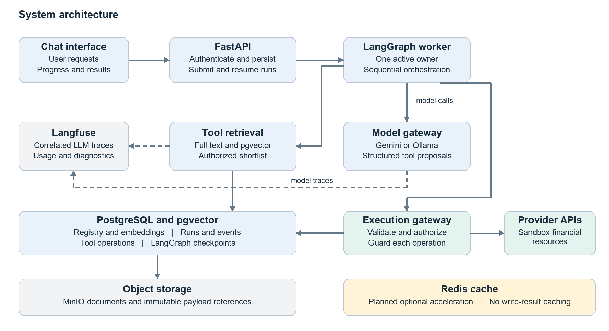
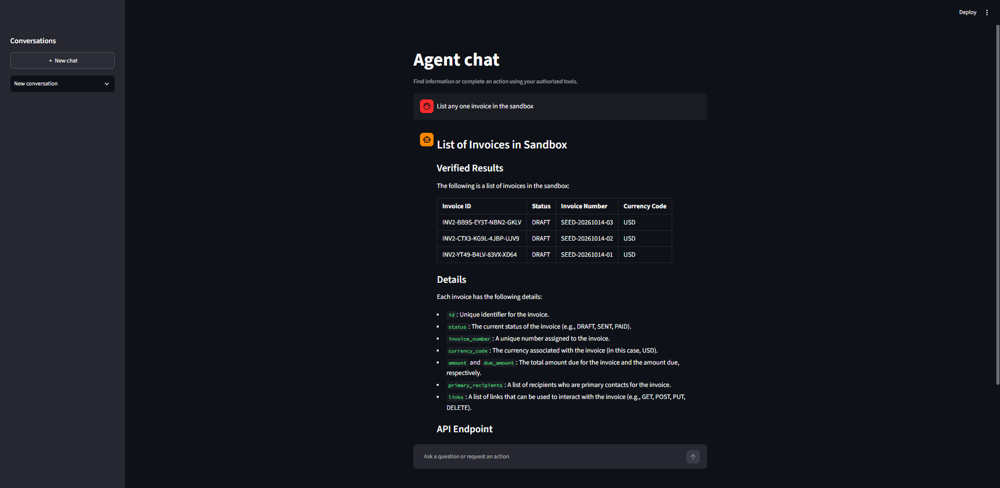
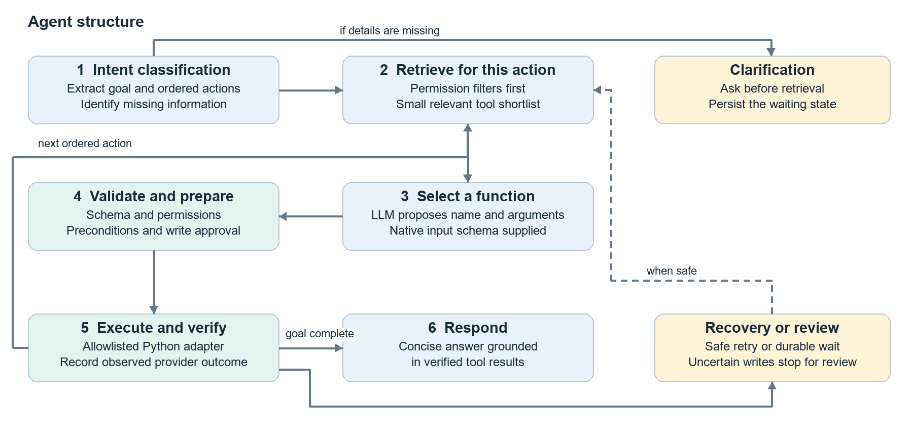
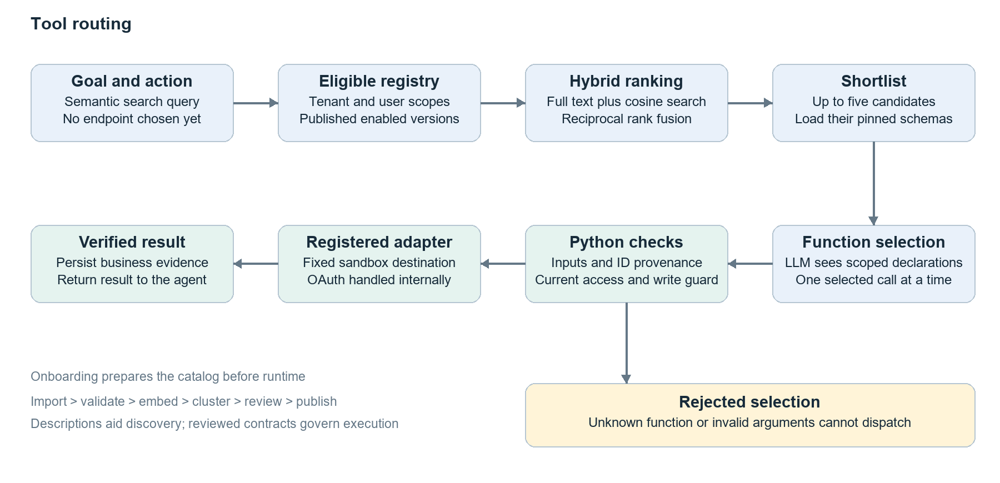
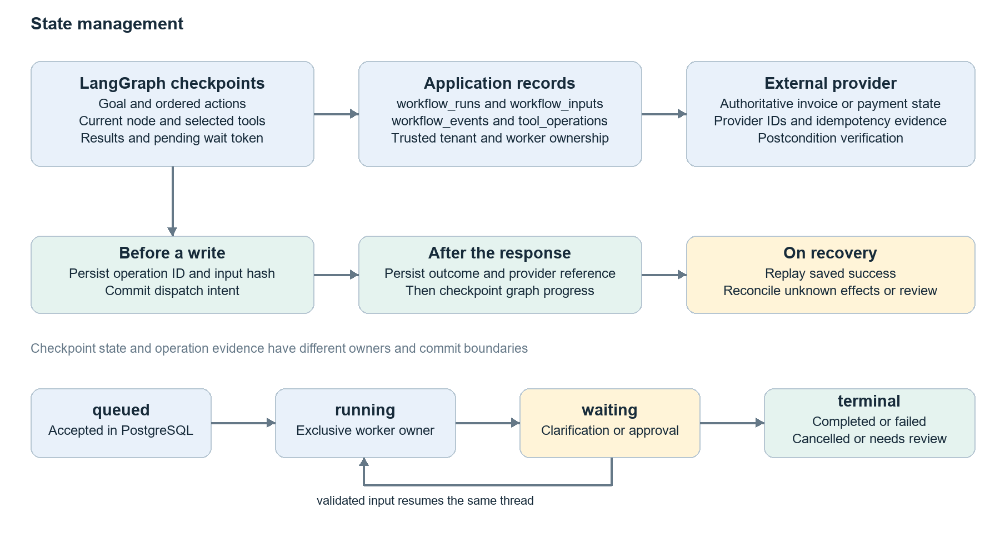

# Simplified Agentic System

A Python agent that turns business requests into ordered actions, retrieves a small
set of authorized tools, and validates model-proposed calls before execution.
The full API catalog stays in the registry rather than appearing in every prompt.

## Contents

- [Features](#features)
- [Architecture](#architecture)
- [Getting started](#getting-started)
- [Agent and execution](#agent-and-execution)
- [Tool onboarding](#tool-onboarding)
- [Testing](#testing)
- [Documentation](#documentation)

## Features

- **Agent:** intent classification → retrieval → function selection → Python validation
  → execution → verified results → grounded response.
- **Tool discovery:** versioned cards, tenant/scope filters, embeddings and reviewed
  taxonomy. The checkpointed workflow uses full-text/vector hybrid retrieval.
- **State:** PostgreSQL stores conversations, runs, events and operation evidence;
  LangGraph checkpoints support workflow pauses and recovery.
- **Integrations:** sandbox financial APIs, scoped document RAG and System Search;
  MinIO stores original documents, and Langfuse provides optional diagnostics.
- **Models:** Ollama `llama3.2` for local generation; Gemini
  `gemini-3.1-flash-lite` as an alternative; `gemini-embedding-2` with 768 dimensions
  for retrieval. Ollama generation still requires Gemini credentials for embeddings.

## Architecture



## Getting started

## Agent and execution

The model identifies the goal and ordered actions. For each action, the application
retrieves an authorized shortlist and supplies the corresponding function schemas.
The model proposes a call; Python validates and dispatches it, then returns the result
to the model for continuation and a final answer.

### Recorded example

> List the invoices in the sandbox

Recorded on Using Ollama `llama3.2` for classification and tool selection. The supplied logs and exchange show:

1. **Classify:** the model returned the following goal plan:

   ```json
   {
     "user_goal": "List invoices",
     "tool_actions": ["List invoices"],
     "missing_information": []
   }
   ```

2. **Retrieve — 10:15:19:** five candidates were returned: List invoices,
   Show invoice details, List templates, Search for invoices, and Show template details.
3. **Select and dispatch — 10:15:25:** the model chose `t1_list_invoices`,
   mapped to registry tool `paypal_get_1e32579a6913`. The adapter called
   `GET /v2/invoicing/invoices` on the sandbox host.
4. **Observe — 10:15:27:** execution succeeded with HTTP 200 and three draft
   invoices for USD 30, USD 20 and USD 10. No write was dispatched.
5. **Continue — 10:15:37:** the model received the result and selected no further tools.
6. **Respond — 10:16:34:** the final response completed with 7,402 characters.

One returned invoice was `INV2-BB9S-EY3T-NBN2-GKLV`, status `DRAFT`, amount
**USD 30.00**.

### Final result shown in the UI

The following is a list of invoices in the sandbox:

| Invoice ID | Status | Invoice Number | Currency Code |
| --- | --- | --- | --- |
| INV2-BB9S-EY3T-NBN2-GKLV | DRAFT | SEED-20261014-03 | USD |
| INV2-CTX3-KG9L-4JBP-UJV9 | DRAFT | SEED-20261014-02 | USD |
| INV2-YT49-B4LV-83VX-XD64 | DRAFT | SEED-20261014-01 | USD |

#### Details

Each invoice has the following details:

- `id`: Unique identifier for the invoice.
- `status`: The current status of the invoice (e.g., DRAFT, SENT, PAID).
- `invoice_number`: A unique number assigned to the invoice.
- `currency_code`: The currency associated with the invoice (in this case, USD).
- `amount` and `due_amount`: The total amount due for the invoice and the amount due, respectively.
- `primary_recipients`: A list of recipients who are primary contacts for the invoice.
- `links`: A list of links that can be used to interact with the invoice (e.g., GET, POST, PUT, DELETE).



## Tool onboarding

```powershell
.venv\Scripts\python.exe -m app.cli onboard-collection "Postman API collection/PayPal APIs.postman_collection.json" --fetch-specs --enable-supported --reviewer manual
```

The standard onboarding flow converts one card per method/endpoint, validates
supported contracts, embeds descriptive metadata, clusters capabilities, reviews
labels and publishes eligible cards. Unsupported entries remain drafts. Use
`--reviewer gemini` for model-assisted descriptive review; execution policies remain
subject to deterministic checks. Reports are saved under `runtime/tool-drafts/`.
The saved inventory records 113 endpoint cards: 91 retained and 22 drafts, not a live
registry count.

Sandbox calls require `PAYPAL_SANDBOX_CLIENT_ID`, `PAYPAL_SANDBOX_CLIENT_SECRET`,
`PAYPAL_SANDBOX_TENANT_ID` and the appropriate identity scopes. Writes additionally
require `PAYPAL_SANDBOX_WRITES_ENABLED=true`. Credentials stay in trusted configuration.

### Prerequisites

- Python 3.11+
- Docker Desktop
- Ollama running the configured model

### Setup and launch

1. For first-time setup, copy `.env.example` to `.env`. Configure database and MinIO
   access, `GEMINI_API_KEY`, model/embedding settings, and `AUTH_BINDINGS_JSON`.
   Keep the embedding model, version and dimension consistent with the database.
2. Provide `runtime/local-auth.json` containing the local bearer token and tenant
   details matching the server-side identity binding. These local files are ignored.
3. From PowerShell in the project root, run:

```powershell
.\start.ps1
```

The script installs missing dependencies, starts PostgreSQL and MinIO, applies
migrations, prepares document storage, and launches chat at `http://127.0.0.1:8501`.
It selects another port through 8510 when needed. Keep the terminal open; closing
it stops processes and infrastructure started by that invocation. Use `-SkipInstall`
to skip installation or `-SetupOnly` to prepare the data services without the UI.

### Runtime options

Current startup launches the direct Streamlit chat, which
uses semantic shortlists and PostgreSQL history without worker/checkpoint recovery.
Enabled sandbox writes execute directly there. The separate FastAPI/LangGraph path
provides the report's checkpointed execution, write approvals and operation guards:

```powershell
.venv\Scripts\python.exe -m app.cli setup-checkpoints
.venv\Scripts\python.exe -m app.main
# In another terminal:
.venv\Scripts\python.exe -m app.worker.main
```


## Testing

```powershell
.venv\Scripts\python.exe -m pytest tests/unit -q
```

Database integration tests require an isolated test database; see
[the integration guide](tests/integration/README.md). Do not use the development
database as a disposable test target.


## Documentation

- [Solution report](docs/Refined-version/Agentic_System_Design_and_Implementation_Report.docx)
- [High-level design](HLD.md)
- [Low-level design](LLD.md)
- [Integration test guide](tests/integration/README.md)


## Agent structure

Intent classification, action planning, tool selection and execution in the agent workflow.



## Tool routing

Tool onboarding, retrieval and validation before dispatch.



## State management

Run state, checkpoints and recovery in the checkpointed workflow described in the report.


